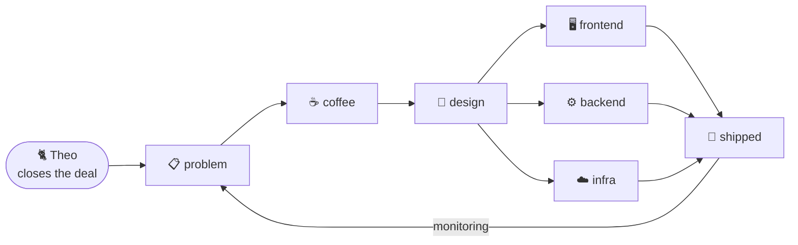

<p align="center">
  <a href="https://git.io/typing-svg"></a>
</p>

> 🐈 **Hi, I'm Theo, head of sales.** You're probably wondering why there's a cat in the profile picture.
> I represent one (1) software engineer. Please read the brochure below. I work on commission (treats).

```http
GET /chaad HTTP/1.1
Host: github.com
Accept: application/json
X-Referred-By: theo-the-cat
```

```json
{
  "status": "ok",
  "data": {
    "name": "Chaad",
    "role": "Software Engineer",
    "builds": "systems, end to end",
    "layers": [
      "frontends people actually click on",
      "APIs and backends that hold the business together",
      "infrastructure that keeps all of it running at 3 AM"
    ],
    "beliefs": [
      "a system is only as good as its worst log line",
      "boring technology is a feature",
      "if you do it twice, automate it",
      "every retry should be safe to retry"
    ]
  },
  "meta": { "sales_rep": "theo", "commission": "treats" }
}
```

### 🏗️ Architecture of a Chaad



### 📦 Dependencies

<p>
  
</p>

### 💼 Pricing (by Theo)

| | 🐾 **Starter** | 🐈 **Pro** | 🦁 **Enterprise** |
|---|:---:|:---:|:---:|
| Code that works | ✅ | ✅ | ✅ |
| Tests that prove it | | ✅ | ✅ |
| Infra that scales it | | | ✅ |
| Theo sits on the keyboard | ✅ | ✅ | ✅ (premium) |
| **Price** | 1 treat | 3 treats | let's talk |

### 🧾 Incident log

| # | event | status | note |
|---|-------|:------:|------|
| 1 | `bug.reported` | `500` | reproduced locally |
| 2 | `bug.reported` | `500` | added logs, still a mystery |
| 3 | `cat.on.keyboard` | `418` | root cause found. it was Theo |
| 4 | `fix.deployed` | `200` | Theo moved to sales. stable since |

---

<p align="center">
  <br/>
  <sub><code>Connection: keep-alive</code> · Theo will follow up with you shortly 🐈</sub>
</p>
